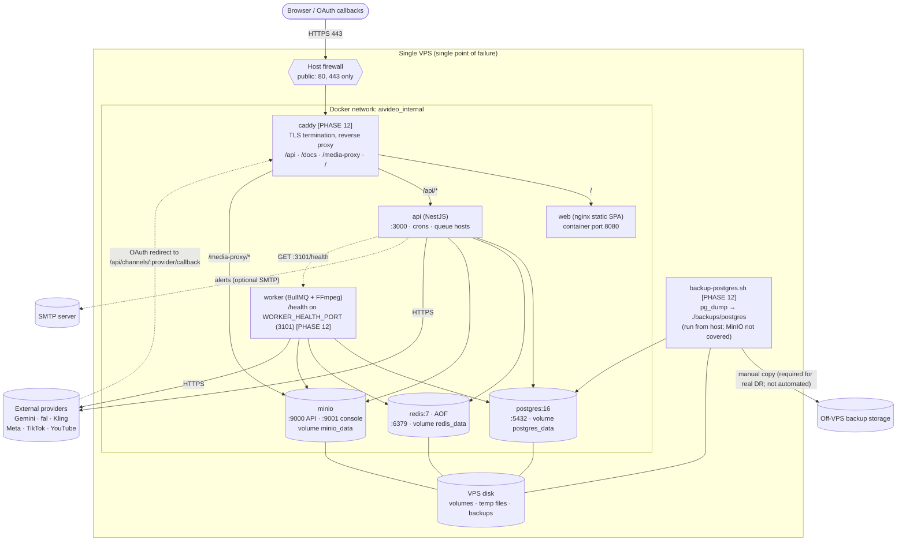

# Production Architecture

This document describes how the AI Video Automation Platform is set up to run in production (`docker-compose.prod.yml` and friends exist in the repo), and where that design is weak.

**Be clear about what this is:** a **single-VPS, single-host** deployment. It is **not highly available**. If the VPS goes down, everything goes down. The design goal is *recoverable* (backups plus a documented restore), not *redundant*. **Nothing described here has been run on a VPS, and no restore has ever been tested.**

## How to read this document

Every component is tagged:

| Tag | Meaning |
| --- | --- |
| **[REPO]** | Exists in the repository (code/config read; **not** run on a VPS). |
| **[PHASE 12]** | Added by Phase 12 and **now present in the repo**. "Present" means implemented and, where noted, covered by local unit/e2e tests. It does **not** mean tested on a VPS or against live providers. |
| **[GAP]** | Known remaining gap or unverified behaviour. |

Phase 12 artifacts in the repo: `docker-compose.prod.yml`, `infrastructure/caddy/Caddyfile`, `infrastructure/redis/redis.prod.conf`, `infrastructure/docker/Dockerfile.{api,worker,web}`, `scripts/{deploy,update,rollback,backup-postgres,restore-postgres}.sh` and `scripts/lib/common.sh`, `.env.production.example`, `GET /api/health/ready` and `/live`, the worker HTTP `/health`, Redis distributed cron locks, the ADMIN-only `/api/ops/*` API, the System Ops page at `/system`, `AlertsService` with optional SMTP, `CleanupService`, the token-maintenance cron, `validateProductionConfig`, `ROLLOUT_STAGE`, and the `phase12_ops` migration.

## Components

| Component | Tech | Source | Notes |
| --- | --- | --- | --- |
| Web | React + Vite, served by unprivileged nginx 1.27-alpine on `:8080` | **[REPO]** `apps/web`, `infrastructure/docker/Dockerfile.web`, `nginx.web.conf` | Static SPA; non-root user, `HEALTHCHECK` on `/healthz`. Admins also get a **System Ops** page at `/system` **[PHASE 12]**. `VITE_API_URL` is **baked in at build time** (Docker build arg). Changing the domain requires rebuilding the `web` image. |
| API | NestJS 10, Prisma 6, Passport JWT, Swagger | **[REPO]** `apps/api`, `Dockerfile.api` | Listens on `PORT` (default `3000`), global prefix `API_PREFIX` (default `api`). Also hosts in-process `@nestjs/schedule` crons (automation tick, analytics, ops monitor every minute, hourly cleanup, 30-minute token maintenance) and BullMQ queue hosts. Crons take Redis locks (`lock:cron:*`) **[PHASE 12]**. Non-root image with `HEALTHCHECK` on `/api/health/live` **[PHASE 12]**. |
| Worker | BullMQ workers + FFmpeg/FFprobe | **[REPO]** `apps/worker`, `Dockerfile.worker` | Internal HTTP `/health` on `WORKER_HEALTH_PORT` (default `3101`) **[PHASE 12]**, not published. Returns 200 while the process is up (does not probe Redis/Postgres). FFmpeg is installed in the image; `FFMPEG_THREADS` limits its threads. Concurrency is set by `WORKER_CONCURRENCY` plus per-queue overrides (`VIDEO_RENDER_`, `IMAGE_GENERATION_`, `PUBLISHING_`, `KLING_`, `GEMINI_TTS_` `*_MAX_CONCURRENCY`). Non-root image with `HEALTHCHECK`; graceful shutdown kills FFmpeg children after `WORKER_SHUTDOWN_TIMEOUT_MS`; logs a warning at 90% of `WORKER_MEMORY_LIMIT_MB`. |
| PostgreSQL | `postgres:16-alpine`, volume `postgres_data` | **[REPO]** `docker-compose.yml`, **[PHASE 12]** `docker-compose.prod.yml` (internal network only, 1 GB limit, log rotation, `./backups/postgres` mounted at `/backups`) | System of record: users, stories, jobs, renders, publications, analytics, encrypted channel credentials. |
| Redis | `redis:7-alpine`, `--appendonly yes`, volume `redis_data` | **[REPO]** dev; **[PHASE 12]** prod | BullMQ queues and cron locks. The prod compose file passes `--requirepass ${REDIS_PASSWORD}` and `--maxmemory ${REDIS_MAXMEMORY}` and mounts `infrastructure/redis/redis.prod.conf` (AOF, `noeviction`, `FLUSHALL`/`FLUSHDB`/`DEBUG` disabled). The dev compose file still does **not** set a password (see [Insecure defaults](#insecure-defaults-in-the-repo-today)). |
| MinIO | `minio/minio:latest` in dev; **pinned `RELEASE.2024-12-18T13-15-44Z`** in prod. Volume `minio_data` | **[REPO]** / **[PHASE 12]** | S3-compatible store for images, clips, audio, final MP4/SRT. Bucket `MINIO_BUCKET` (default `ai-video`) is created by `StorageService.ensureBucket()` at API start. |
| Reverse proxy | `caddy:2.8-alpine` (automatic HTTPS) | **[PHASE 12]** `infrastructure/caddy/Caddyfile` | Only service that publishes ports (`HTTP_PORT`/`HTTPS_PORT`, default 80/443). Routes `/api/*`→`api:3000`, `/docs*`→`api:3000`, `/media-proxy/*`→`minio:9000` (prefix stripped), everything else→`web:8080`. Sets HSTS, nosniff, frame-deny, referrer-policy; **no CSP**. Not run on a VPS; certificate issuance unverified. |
| Monitoring and alerts | `/api/health*`, worker `/health`, `AlertsService`, optional SMTP, ops monitor cron, `/api/ops/*`, `/system` page | **[PHASE 12]** | See `MONITORING_AND_ALERTS.md`. Alerts are stored in the DB and emailed only if SMTP is configured; no real mailbox has received one. |
| Backups | `scripts/backup-postgres.sh` (gzip, optional openssl encryption, retention) and `scripts/restore-postgres.sh` | **[PHASE 12]** (Postgres only) | See `BACKUP_AND_RESTORE.md`. **There is no MinIO backup script** **[GAP]**. The restore script has never been run against a real dump. |

### External providers

All provider calls go out from the API (planning, some cost/usage code) or the **worker** (the heavy lifting). Credentials come from env vars.

| Provider | Used for | Env prefix | Mock flag |
| --- | --- | --- | --- |
| Google Gemini | Story and scene planning, motion briefs, narration planning | `GEMINI_*` | `GEMINI_USE_MOCK` (also automatic when `GEMINI_API_KEY` is unset or `NODE_ENV=test`) |
| Gemini TTS | Narration audio | `GEMINI_TTS_*` | `GEMINI_TTS_USE_MOCK` |
| fal.ai | Scene images and character references | `FAL_*` | `FAL_USE_MOCK` |
| Kling | Image-to-video clips | `KLING_*` | `KLING_USE_MOCK` |
| Meta (Facebook / Instagram) | OAuth and publishing | `FACEBOOK_*`, `INSTAGRAM_*` | `FACEBOOK_USE_MOCK`, `INSTAGRAM_USE_MOCK`, `SOCIAL_USE_MOCK` |
| TikTok | OAuth and publishing | `TIKTOK_*` | `TIKTOK_USE_MOCK` (`TIKTOK_AUDITED` gates public posting) |
| YouTube | OAuth and publishing | `YOUTUBE_*` | `YOUTUBE_USE_MOCK` |

> **No provider integration is claimed as verified against live production accounts.** Mock mode is the tested path. See `PRODUCTION_CHECKLIST.md`.

## Deployment diagram

Notes on the diagram:

- **Only Caddy publishes host ports.** Postgres, Redis, MinIO, API, worker and web stay on the internal `aivideo` bridge network. `docker-compose.prod.yml` is built that way (only the `caddy` service has `ports:`; **not verified from outside a VPS**). The dev `docker-compose.yml` does the opposite, so it must not be used on a VPS.
- Caddy routes `/api/*` to `api:3000`, `/docs*` to `api:3000` (Swagger exists only if `SWAGGER_ENABLED=true`), `/media-proxy/*` to `minio:9000`, and everything else to `web:8080`. The same-origin layout avoids most CORS and cookie complications; `.env.production.example` ships `VITE_API_URL=/api` (build-time).
- OAuth redirect URIs (`FACEBOOK_REDIRECT_URI`, `INSTAGRAM_REDIRECT_URI`, `TIKTOK_REDIRECT_URI`, `YOUTUBE_REDIRECT_URI`) must be public HTTPS URLs on that domain, registered with each provider.

## Request and job flow

1. The browser calls the API with `Authorization: Bearer <access token>`. The refresh token lives in an httpOnly cookie scoped to `COOKIE_PATH` (default `/api/auth`).
2. Long-running work is never done in a request. The API writes a `GenerationJob` row and enqueues a BullMQ job (`jobId = generationJobId`). The worker processes it and writes results to Postgres and MinIO.
3. Pipeline queues (from `packages/shared/src/queues`):
   - **Story**: `story-generation` → `scene-planning`
   - **Visuals**: `visual-analysis` → `character-reference-generation` / `image-generation`
   - **Motion**: `motion-analysis` → `video-generation` → `video-status-polling` → `video-download`
   - **Voice**: `narration-planning` → `speech-generation` → `audio-validation` → `audio-storage`
   - **Render**: `video-render-planning` → `video-rendering` → `video-render-validation` → `video-render-storage`
   - **Publishing**: `social-publishing`, `social-media-upload`, `social-publish-status`, `social-token-maintenance`
   - **Automation**: `automation-daily-planner`, `automation-orchestrator`, `automation-publish-scheduler`
   - **Analytics**: `analytics-sync`, `analytics-post-refresh`, `analytics-account-refresh`, `analytics-aggregation`
4. Delayed polling (Kling) is implemented with delayed BullMQ jobs, so it does not hold a worker slot.

## Single points of failure

All of these follow from "one VPS":

| SPOF | Impact | Mitigation today | Residual risk |
| --- | --- | --- | --- |
| The VPS (hardware, hypervisor, provider outage) | Total outage: UI, API, workers, data | Postgres backup script **[PHASE 12]** (local dir; off-VPS copy is manual and not set up) | Recovery means provisioning a new VPS and restoring. Target RTO is about 1–2 hours, **assuming off-VPS backups exist**. |
| VPS disk | Loss of Postgres, Redis, MinIO and local backups together | None until backups are copied off-host | **Local-only backups on the same disk are not backups.** |
| Postgres (single instance, no replica) | API unusable; worker jobs fail | `restart: unless-stopped`, healthcheck, `/api/health/ready` + ops monitor alert **[PHASE 12]** | Data loss since last dump (RPO target 24h). |
| Redis (single instance) | No queue processing; API enqueue fails; cron locks fail closed (a tick is skipped when the lock cannot be taken) | AOF on, `noeviction`, password **[PHASE 12]** | AOF has bounded loss on crash. Queued jobs can be lost or stalled. Reconcile via the Jobs page. |
| MinIO (single node, single drive) | Media and renders unreadable | None. **No MinIO backup script exists.** | All generated assets are lost if the volume dies and there is no copy. |
| One worker container | No generation or rendering while down | `restart: unless-stopped`, healthcheck, ops-monitor `worker_down` alert **[PHASE 12]** | Jobs queue up; they do not run elsewhere. |
| API process hosting crons | Automation tick, publish scheduler and analytics cron stop | `restart: unless-stopped` | Automation, analytics, ops-monitor, cleanup and token-maintenance crons are guarded by Redis locks (`SCHEDULER_LOCK_TTL_SECONDS`, `DistributedLockService`) **[PHASE 12]**, so replicas should not double-run them. Unit-tested only; multi-replica operation was never run. The compose file runs a single `api`. |
| Caddy / certificate renewal | HTTPS outage | Caddy auto-renews (config present; **never issued a cert**) **[PHASE 12]** | Requires ports 80/443 reachable and a valid DNS record. |
| DNS and domain registrar | Users and OAuth callbacks fail | None | Keep registrar credentials safe. |
| The alerting path | Alerts are sent from the same VPS, so **a dead VPS cannot alert** | Optional SMTP **[PHASE 12]** (untested against a real relay) | Use an **external** uptime monitor on `/api/health/live`. |
| Secrets in `.env` | Lost `CREDENTIALS_ENCRYPTION_KEY` makes stored OAuth tokens unrecoverable | None | Store a copy in a password manager, separately from DB backups. |

## Bottlenecks

- **FFmpeg rendering is CPU and RAM heavy.** Defaults keep it at `VIDEO_RENDER_MAX_CONCURRENCY=1`. One 1080×1920 render can saturate small VPS CPUs for minutes (`VIDEO_RENDER_JOB_TIMEOUT_MS` defaults to 900000, i.e. 15 min). Phase 12 adds `FFMPEG_THREADS` (default 2) and `WORKER_MEMORY_LIMIT_MB` (default 2048; warning only, it does not throttle work). Render load on a real VPS has **not** been measured.
- **Worker and API share the same host.** A render can starve the API of CPU and make health checks flap. `docker-compose.prod.yml` sets worker limits via `WORKER_MEMORY_LIMIT`/`WORKER_CPU_LIMIT` (defaults `2G`/`2.0`) and api limits via `API_MEMORY_LIMIT`/`API_CPU_LIMIT` **[PHASE 12]**; sizes are unmeasured guesses.
- **Disk.** Temp files go to the container's `os.tmpdir()` (confirmed in `ffmpeg.ts`, `audio-validation.ts`, `social-publishing.processor.ts`). Container filesystem growth, MinIO objects, Postgres, backups and Docker logs all share one disk. `CleanupService` removes stale temp files and `tmp/` MinIO objects hourly (`TEMP_CLEANUP_MAX_AGE_HOURS`), and the ops monitor alerts at `DISK_USAGE_ALERT_PERCENT`, but its `df` runs inside the API container so host/volume usage is not reliably covered **[GAP]**. `docker-compose.prod.yml` configures `json-file` log rotation on every service; the dev compose file does not.
- **Provider rate limits and latency.** Per-provider concurrency knobs: `KLING_MAX_CONCURRENCY`, `GEMINI_TTS_MAX_CONCURRENCY`, `IMAGE_GENERATION_MAX_CONCURRENCY` and `PUBLISHING_MAX_CONCURRENCY` **[PHASE 12]**. Provider cost has per-provider monthly spend guards for Kling and Gemini TTS only. There is no global spend cap.
- **Single Redis connection domain.** All queues share one Redis; a flood in one queue (for example analytics) can delay others. There are no per-queue priorities beyond BullMQ defaults.
- **Per-IP rate limiting behind a proxy.** The throttler (global 100 requests/min, auth routes lower) keys on client IP. `TRUST_PROXY` **[PHASE 12]** (also forced on when `NODE_ENV=production`) makes the API trust one proxy hop; without it every request appears to come from Caddy and **all users share one bucket**. Not verified behind a real Caddy.
- **Graceful shutdown vs long jobs.** The worker closes BullMQ workers on `SIGTERM`, waits up to `WORKER_SHUTDOWN_TIMEOUT_MS` (90 s), then kills FFmpeg children and exits. The prod compose gives the worker `stop_grace_period: 120s` (api: `30s`). A render can take up to 15 min (`VIDEO_RENDER_JOB_TIMEOUT_MS`), so a restart mid-render **will** interrupt it; the job fails/stalls and must be retried.

## Known gaps in the repo today

These are real behaviours found in the code, not hypotheticals.

### Health checks and observability (Phase 12 status)

| Item | Status |
| --- | --- |
| `GET /api/health` | **[REPO]** Terminus check of Postgres (`SELECT 1`), Redis (`PING`) and MinIO. |
| `GET /api/health/ready` | **[PHASE 12]** Implemented; same three checks as `/api/health`. |
| `GET /api/health/live` | **[PHASE 12]** Static JSON with `service`, `environment`, `version`, `timestamp`. Process liveness only; checks nothing. |
| Worker `/health` (and `/health/live`) on `WORKER_HEALTH_PORT` | **[PHASE 12]** Implemented. Returns 200 with uptime, queue names, `ffmpegAvailable`, memory/pressure whenever the process is up. **[GAP]** It does not verify Redis/Postgres connectivity, so a worker that has lost Redis can still report "ok". |
| Docker `HEALTHCHECK` / compose healthchecks | **[PHASE 12]** Present for postgres, redis, minio, api, worker, web. Caddy has none. |
| Queue-depth / stalled-job visibility | **[PHASE 12]** `GET /api/ops/queues`, `/jobs/active`, `/jobs/failed`, `/overview`, and the `/system` page. The ops monitor alerts when a queue has more than 25 failed jobs. **[GAP]** There is no stalled-job alert (`stalled_jobs` is a declared type that nothing fires). |
| Disk metrics | **[GAP]** `df -P /` inside the API container; the `/api/ops/overview` disk figure is a placeholder (`usedPercent: 0`). |

### Insecure defaults in the repo today

The checked-in `docker-compose.yml` and `.env.example` are **development** settings. Using them unchanged on a public VPS is unsafe. Use `docker-compose.prod.yml` and `.env.production.example`; `validateProductionConfig` and `scripts/lib/common.sh` reject several of the insecure values below at startup/deploy.

| Default | Where | Risk | Required action |
| --- | --- | --- | --- |
| Postgres `5433:5432`, Redis `6379:6379`, MinIO `9000`/`9001`, API `3000`, web `5173` all published on **all host interfaces** | `docker-compose.yml` `ports:` | Internet-reachable DB, Redis and MinIO console. **Docker-published ports bypass UFW rules.** | `docker-compose.prod.yml` publishes only Caddy (unverified externally). |
| `POSTGRES_PASSWORD` defaults to `aivideo` | compose and `.env.example` | Guessable DB password | Strong random password. |
| `MINIO_ACCESS_KEY`/`MINIO_SECRET_KEY` default `minioadmin` | compose and `.env.example` | Well-known MinIO admin credentials; the API also uses them as the S3 client credentials | Strong random keys. |
| Redis runs with no `requirepass` | dev `docker-compose.yml` `command` | Unauthenticated queue store. | **Fixed in `docker-compose.prod.yml`** (`--requirepass`); the dev file is unchanged and must not be used on a public host. |
| `JWT_ACCESS_SECRET`, `JWT_REFRESH_SECRET`, `CREDENTIALS_ENCRYPTION_KEY` are `change-me-…` placeholders | `.env.example` | Forged tokens; decryptable stored credentials | Generate unique random secrets (≥32 chars). |
| `COOKIE_SECURE=false`, `COOKIE_SAME_SITE=lax`, `NODE_ENV=development` | `.env.example` | The refresh cookie is sent over HTTP; the example values **override** the safer production code defaults (`secure=true`, `sameSite=strict` when `NODE_ENV=production` and the vars are unset) | Set `NODE_ENV=production`, `COOKIE_SECURE=true`, `COOKIE_SAME_SITE=strict` (or remove the overrides). |
| `CORS_ORIGIN=http://localhost:5173` | `.env.example` | Browser requests from the real domain fail; a lazy fix (`*`) would be unsafe | Set to the exact HTTPS origin. |
| Swagger UI mounted at `/docs` unless gated | `apps/api/src/main.ts` | Exposes the API surface publicly | `SWAGGER_ENABLED=false` (the production example default; `.env.example` ships `true`) **[PHASE 12]**. |
| Open registration (`POST /api/auth/register`), default role `EDITOR` | `auth.service.ts`, `schema.prisma` | Anyone who can reach the API can create an account that can spend provider money | Restrict at the proxy or app level before going public. See `SECURITY.md`. |
| Roles enforced **only on `/api/ops/*`** | `RolesGuard` (global) with `@Roles(ADMIN)` on `OpsController` only **[PHASE 12]** | Every other route ignores `role` (ADMIN/EDITOR/VIEWER) | Treat all non-ops authenticated users as equally privileged until broader RBAC is added. `ADMIN_EMAIL` does not grant admin; the first admin needs a DB update. |
| Mock flags default on for fal/Kling/TTS (`FAL_USE_MOCK=true`, `KLING_USE_MOCK=true`, `GEMINI_TTS_USE_MOCK=true`) | `.env.example` | Silent fake output in production if forgotten. Gemini also silently mocks when the key is empty. | Explicitly set mock flags per rollout stage. |
| Dockerfiles install with `--frozen-lockfile=false` (MinIO is pinned in the prod compose; dev still uses `latest`) | Dockerfiles | Non-reproducible builds, surprise upgrades | Use a frozen lockfile in production builds. |
| ~~API and worker containers run as root; no `HEALTHCHECK`~~ | Dockerfiles | **Addressed in Phase 12**: `Dockerfile.{api,worker,web}` run as non-root `aivideo` and define `HEALTHCHECK`. Not verified at runtime (e.g. volume ownership for `worker_tmp`). | Verify on a VPS. |
| No Docker log rotation | dev compose only | Logs can fill the disk | **Configured in `docker-compose.prod.yml`** (`json-file`, per-service `max-size`/`max-file`). |
| API presigned URLs use the **internal** `MINIO_ENDPOINT` | `StorageService` | With MinIO unpublished, browser preview and download links (`http://minio:9000/...`) are unreachable. `MINIO_PUBLIC_URL` is only honoured by two **worker** processors (image/video generation reference URLs), **not** by the API. Caddy now has a `/media-proxy/*` route to MinIO, but the API does not use it for browser URLs. **Still unresolved [GAP].** | Resolve before real use: have the API sign against the public proxied host, or proxy downloads through the API. See `DEPLOYMENT.md` known issues. |
| Access token stored in browser `localStorage` | `apps/web/src/lib/api.ts` | XSS could steal the 15-minute access token | Keep CSP tight (Caddy sets no CSP today; helmet applies to API responses only) and keep access-token TTL short. |

## Operational constraints worth remembering

- **Never wipe volumes.** `postgres_data`, `redis_data` and `minio_data` are the system state. `docker compose down` is safe; `docker compose down -v` is **destructive**.
- **Migrations are forward-only.** Prisma migrations ship in `apps/api/prisma/migrations` (12 migrations, `init` through `phase12_ops`). Application rollback does not undo schema changes.
- **[PHASE 12.1]** Prod compose runs `api` with `PROCESS_ROLE=api` (HTTP + producers) and singleton `api-scheduler` with `PROCESS_ROLE=scheduler` (Nest crons + automation/analytics BullMQ hosts). Do not scale `api-scheduler`. Redis locks remain belt-and-suspenders. Disable flags (`*_CRON_DISABLED`, `*_QUEUE_HOST_DISABLED`, …) still exist for incidents.
- **Emergency stop exists in the app.** `POST /api/automation/emergency-stop` sets `AutomationRunMode.EMERGENCY_STOP`. See `INCIDENT_RESPONSE.md`. Phase 12 adds `POST /api/ops/automation/global-pause` and the `ROLLOUT_STAGE` gate (stages A/B skip the automation tick entirely).

## Related documents

- `DEPLOYMENT.md`: install, update, rollback, reboot recovery
- `ENVIRONMENT_VARIABLES.md`: every variable, required vs optional
- `BACKUP_AND_RESTORE.md`: backup, restore, RPO/RTO
- `MONITORING_AND_ALERTS.md`: health endpoints and alerts
- `SECURITY.md`: auth, encryption, hardening
- `INCIDENT_RESPONSE.md`: runbooks
- `PRODUCTION_CHECKLIST.md`: staged rollout and verification state
